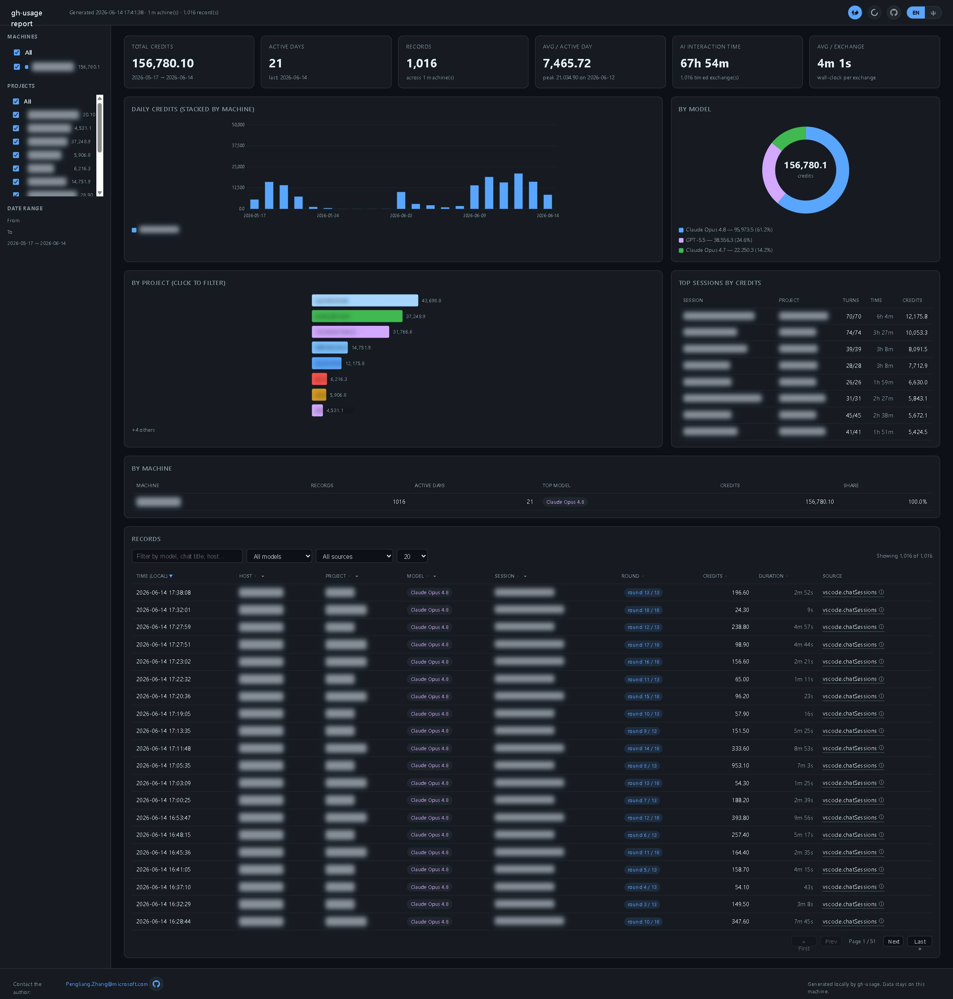
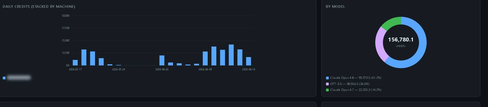
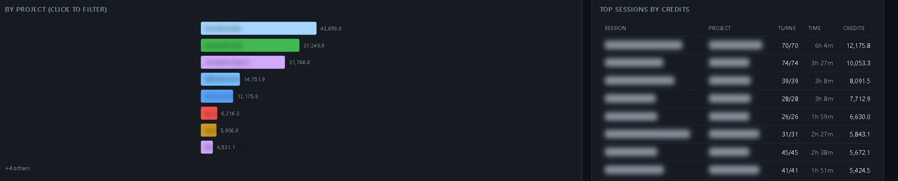
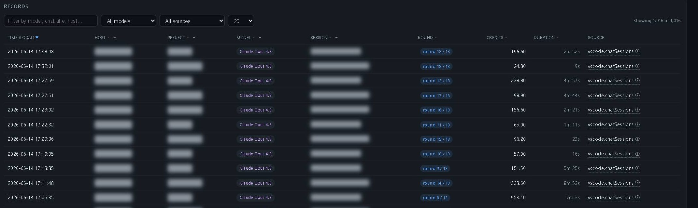

# gh-usage · 一眼看懂你的 Copilot 用量

[English](../README.md) | 简体中文

[](LICENSE)
[](https://www.rust-lang.org/)
[](#-三步上手)
[](https://github.com/kukisama/gh-usage/releases)

> 一条命令，把本机零散的 GitHub Copilot 使用记录，整理成一份可视化报告。
> 不上传、不联网，数据始终留在你自己的电脑上。

[查看 1.2.5 更新](CHANGELOG.zh-CN.md#125--2026-11-23)



---

## 🙋 适合谁用

- **重度 Copilot 用户**：想知道这个月用了多少额度（credits）、哪几天用得最多、主力模型是哪个。
- **团队负责人 / 技术主管**：想看清成员之间、项目之间的用量分布，便于复盘和盘点。
- **需要对外汇报的人**：想要一份能直接截图发出去的报告，而不是一堆原始日志。

---

## ✨ 核心特性

### ⚡ 快

使用 Rust 编写，扫描本机历史目录高效、占用低。在一次本机实测中，它在 **1.52 秒**内处理了 **877 个文件**，提取出 **1020 条记录**。

```text
+- GitHub Copilot Usage ---------------------------------+
| records               1020  scanned files          877 |
| total credits     157204.3  candidate lines        102 |
| active days             21  parse errors             0 |
| avg / day           7485.9  total time          1.52 s |
+--------------------------------------------------------+
```

### 🔒 本地、私密

- **全程本地运行**：只读取电脑上已有的文件，不联网、不上传。
- **一键隐私遮蔽**：报告内置隐私开关，开启后主机名、项目名、会话标题都会被打码，截图分享更安心。
- **数据自己掌控**：所有结果都写入你指定的本地文件，留或删都由你决定。

### 🖥️ 报告好看也好用

报告是一个**单文件 HTML**，双击即可在任意浏览器打开——无需数据库、无需服务器、无需联网。深色主题、排版清爽，并内置中英文切换。

---

## 📊 报告里有什么

「用量」查看 GitHub AI 积分，「精力时间」查看人工提交占用的时段，有旧制记录时还会显示「历史请求」。机器和项目筛选跨表联动，历史请求保留独立的日期范围。

### 核心指标一览

总额度、活跃天数、记录条数、日均用量、AI 交互总时长、单次平均时长，关键数字都集中在顶部。


### 趋势与模型分布

每日用量柱状图帮你看出哪几天最忙，环形图直观展示各模型的占比。



### 按项目、会话深入

项目维度的横向条形图支持点击筛选，配合「最高消耗会话」榜单，定位用量都花在了哪里。



### 可搜索、可筛选的明细表

明细记录表支持关键词搜索、按模型/来源筛选、点击表头排序和分页。下图开启了隐私模式，敏感字段已自动打码。

**按「会话 → 用户交流轮次」理解。** 一轮是一次用户请求及其后续 Agent 工作，不是一次工具、MCP 或子代理调用。已知轮次每轮一行，额度包含日志已记录的子任务用量，不展开子任务账单。CLI 同轮的多模型记录会在页面合并展示，CSV/JSON 保留来源汇总便于核对。旧 CLI 日志只有会话总额时标为「会话汇总」，不虚构轮次。

**同时兼容新旧 VS Code 日志。** 重放快照和更新，有累计 `copilotCredits` 时优先读取，没有时沿用 `result.details`。两者并存时核对更完整的总额（允许文案四舍五入误差），绝不相加，也不再次累加已包含的子任务费用。进行中或中断的轮次没有最终文案也能计入；其他轮次缺少用量不会导致后续轮次重新编号。模型列是轮次归属，不是子代理逐模型账单。

回退/重试不会撤销日志已记录的消费：能够识别的先前请求保留为**历史轮次**，计入会话的累计交流次数与额度，即使它已不再显示在当前对话中。

同时读取工作区和空窗口聊天的 JSON 快照与 JSONL 日志。没有最终费用文案时，保留该轮已记录的最高累计值。VS Code 会话总额高于已归入各轮的额度时，只将差额记为会话未归因用量，不虚构轮次或模型。

对于 Copilot CLI 记录，`events.jsonl` 保持为可追溯的主来源，SQLite 负责补充精确 credits 和耗时。在记录来源弹层中点击「打开」，即可在 VS Code 中跳到对应的 JSONL 事件行。



### 历史请求

「历史请求」只展示[旧制时期](https://docs.github.com/zh/copilot/concepts/billing/copilot-requests)的可见记录，每个来源的时间轴止于其最后一条历史记录。VS Code 按请求条目计数，CLI 按日志中的 `requests.count` 统计模型调用，两者分开查看，不乘倍率、不换算金额，也不与 AI 积分合计。无法还原原始次数的旧导出仅供核对；同一会话开始时间、同一计量单位的 CLI 退出摘要不会累加。

### 侧边栏筛选

左侧可按机器、项目、日期范围勾选，报告实时联动，无需额外配置。日期可快捷选择近 7 天、30 天、3 个月或全部（默认），也可以继续手工指定起止日期。


### 可选费用估算

费用显示默认关闭。开启后，报告中的用量数字和图表可以从 AI credits 切换为预估美元或人民币。换算采用 GitHub 官方口径 **1 AI credit = 0.01 美元**；美元兑人民币默认汇率为 **6.75（参考日期：2026-08-06）**，并允许编辑以适应汇率变化。控件旁提供 GitHub 官方账单页面、[AI Credits 官方说明](https://docs.github.com/en/copilot/concepts/billing/usage-based-billing-for-individuals)和 [UsagePricing](https://www.usagepricing.com/blueprint/github-copilot) 的直达链接。

### 一键截图分享

报告右上角的相机按钮可把**整页**保存为一张图片（约 430 KB 的 JPEG，清晰且体积小）。截图时会自动开启隐私遮蔽，分享更放心。

---

## 🚀 三步上手

### 1. 安装

**Windows**（通过 Windows 包管理器）：

```powershell
winget install gh-usage
```

升级：

```powershell
winget upgrade gh-usage
```

**Linux / macOS**：到 [Releases 页面](https://github.com/kukisama/gh-usage/releases) 下载对应平台的压缩包，解压后运行 `gh-usage`。

### 2. 运行

在终端执行：

```powershell
gh-usage
```

它会在当前目录生成两个文件：

- `copilot-usage-<机器名>.csv`——可导入 Excel 做进一步分析
- `copilot-usage-<机器名>.html`——双击即可查看的报告

### 3. 打开报告

执行 `gh-usage --view`，即可生成最新报告并立即用默认浏览器打开。简写为 `gh-usage -v`，也兼容 `gh-usage -view`（`-view` 须放在第一个参数）。仍会保留 CSV 导出，终端无需等待按键即可退出。

也可以直接双击已有的 HTML 文件。搜索、筛选、切换语言、开启隐私、保存截图，都在页面里完成。

---

## 🛠️ 常用命令

一条命令生成并打开：`gh-usage --view`。可以组合筛选条件，例如 `gh-usage --view --since-days 7`；也可以指定报告位置：`gh-usage --view --html report.html`。

`--view` 不能与 `--no-html` 同用。配合 `--output -` 时，CSV/JSON 仍输出到标准输出，HTML 则保存在当前目录的 `copilot-usage-<机器名>.html`（或 `--html <PATH>` 指定位置），浏览器启动提示写入标准错误。不加 `--view` 时，原有终端与自动化运行仍不会打开浏览器。打开报告需要桌面环境及默认 HTML 处理程序；启动失败会明确报错，已生成文件仍保留。

默认会同时纳入 VS Code 和 GitHub Copilot CLI 记录。若只扫描 VS Code：

```powershell
gh-usage --no-cli-logs
```

只扫描最近一周：

```powershell
gh-usage --since-days 7
```

输出到指定位置：

```powershell
gh-usage --output .\reports\copilot-usage.csv --html .\reports\copilot-usage.html
```

导出 JSON 用于自动化、不生成 HTML：

```powershell
gh-usage --format json --output .\reports\copilot-usage.json --no-html
```

### 精力时间带与原始记录导出

HTML 默认包含「精力时间」工作表。可在全时段时间轴上框选、平移或拖动两端调整范围。精力支持**年**（各月汇总）、**月**（日历）、**周**（周一至周日）、**日**（48 个半小时格），统一按北京时间（UTC+08:00）划分。点击某天或亮格可在「关联明细」回查人工提交，不改变范围汇总。传入 `--no-effort` 可省略工作表及其事件数据。用量 CSV 不含原始人工提交时间，合并报告不会推算精力。

- **月视图**：条长表示占全天 24 小时的比例。每日不足 4 小时为绿，4 至不足 8 小时为黄，8 至不足 12 小时为橙，12 小时及以上为红。
- **周视图**：总投入不足 30 小时为绿，30 至不足 50 小时为黄，50 小时及以上为红。半小时格仍按触发次数着色。

用 `gh-usage --since-days 7 --effort-report effort.md` 另存一份 Markdown 报告。它读取 VS Code 原始提交和 Copilot CLI 人工消息，没有 credits 的人工请求也能入表。按北京时间整点／半点划格，跨扫描到的项目和会话去重，一格折算 0.5 小时。报告先列原始时间、来源和排除项，再列每日周期、管理段和覆盖时段。自动事件、无法关联的排队记录、云端运行和回复耗时不计；不自动判定业务相关性，也不补记缺失历史。请使用新路径保留既有报告。

可重复传入 `--effort-project <项目名>`，按项目名精确选取多个项目，对它们的占用格取并集。这个筛选只影响精力报告，不改变 credits 明细，也不按消息判断混合会话里的业务归属。

### 合并多台电脑的报告

在每台机器上分别运行 `gh-usage`，把生成的 `copilot-usage-*.csv` 收集到同一文件夹，然后：

```powershell
gh-usage --merge .\shared\copilot-usage
```

它会读取所有 CSV、对同一机器上的相同记录去重，按新版用量与历史请求分别展示机器汇总。旧 CSV 没有机器名时，按各自的 `copilot-usage-<机器名>.csv` 文件名回填。导出中 `credits` 和 `request_count` 分开存放，`unclassified_usage` 仅供核对。

追加 `--view` 即可立即打开合并报告：`gh-usage --merge .\shared\copilot-usage --view`。可以通过 `--html <PATH>` 指定合并报告位置；相对路径以当前工作目录为基准。

---

## 📄 CSV 字段

每行对应一条来源记录，包含机器、时间、会话、模型、源文件和行号等字段。`credits` 存 AI 积分，`request_count` 存可核实的历史原始次数，`unclassified_usage` 存仅供核对的旧值。这些字段不相加；历史次数按来源比较。CSV 默认带 UTF-8 BOM，方便 Windows Excel 直接打开（用 `--no-bom` 可关闭）。

---

## ⚠️ 使用须知

`gh-usage` 用于**本地分析与复盘**，适合了解趋势、做粗略对比，但**不能替代 GitHub 官方账单或使用量报告**。

- 只扫描本机已有的文件，已删除的历史无法重建。
- 既没有有效累计额度、也没有旧版费用文案的轮次会被跳过，不将未知用量视为免费；进行中的轮次在生成报告后仍可能继续增长。
- 美元/人民币金额仅供本地估算；汇率可由用户调整，最终以 GitHub 官方账单为准。
- Copilot CLI 以事件 JSONL 作为主要追溯记录；会话标题取 `workspace.yaml.name`（未命名时回退 JSONL 首条真实用户消息），项目取 `workspace.yaml.cwd`。仅当 SQLite 用量行匹配 JSONL 响应或 `session.usage_record` 事件时，`session-store.db` 才补充精确 credits、耗时和轮次。未匹配的行不计入报告，终端会提示数量。
- 默认使用当前系统标准的 VS Code 与 Copilot CLI 数据目录，也支持自定义路径。

---

## 📚 选项一览

```text
--no-cli-logs             跳过 GitHub Copilot CLI 记录
--since-days <N>          只扫描最近 N 天内修改过的文件
--output <PATH>           将 CSV 或 JSON 写到指定路径
--html <PATH>             将 HTML 报告写到指定路径
--view, -v                生成 HTML 后立即用默认浏览器打开
--no-html                 不生成 HTML 报告
--effort-report <PATH>    另存本地人工触发的半小时精力报告（Markdown）
--effort-project <NAME>   按精确项目名筛选 Markdown 精力报告（可重复）
--no-effort               从 HTML 中省略精力时间工作表及其数据
--merge [DIR]             合并已有的 copilot-usage-*.csv 为一份报告
--format csv|json         选择输出格式
--hostname <NAME>         覆盖记录中保存的机器名
```

运行 `gh-usage --help` 查看完整命令参考。

---

## 📜 许可

本项目基于 [MIT 许可证](../LICENSE) 开源，可自由使用、修改和分发。

## 🤝 贡献

欢迎提交 Issue 与 Pull Request。如果这个工具对你有帮助，欢迎点一个 ⭐ Star。

---

<sub>由 gh-usage 在本地生成 · 数据始终留在你的电脑上。</sub>
